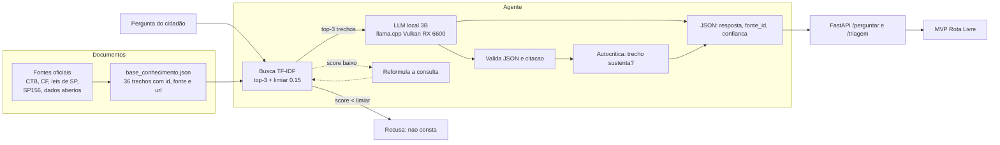

# Relatório — Rota Livre · Treinamento de uma LLM local

Generative AI for Engineering · Global Solution 2026.2 · FIAP · Engenharia de Software 4ES

## 1. Integrantes

| Nome completo | RM |
|---|---|
| Gabriel Gomes Catanzaro | RM93445 |
| Lucas Gomes Alcantara | RM98766 |
| Filipe Prado Menezes | RM98765 |

## 2. Ficha Técnica — o que a IA resolve

- **Produto:** Rota Livre — CitizenTech de reporte e orientação sobre buracos e obstáculos
  em vias e calçadas do município de São Paulo.
- **Cidadão e território:** morador de São Paulo que convive com buracos na via, calçadas
  quebradas e obstáculos — motorista, motociclista, ciclista, pedestre, pessoa com deficiência.
- **Problema em uma frase:** o cidadão não sabe como reportar um buraco, de quem é a
  responsabilidade nem como ser ressarcido de um dano — e "Buraco e Pavimentação" está entre
  os temas mais reclamados da Ouvidoria municipal.
- **O que a IA resolve (tema: mobilidade):**
  1. **Assistente do cidadão**: responde dúvidas (como reportar, responsabilidade, prazos,
     indenização) com base em 36 trechos de fontes oficiais, citando a fonte e recusando com
     "não consta" o que a base não cobre;
  2. **Triagem de relatos**: transforma o relato livre em JSON estruturado
     (tipo, gravidade, órgão sugerido) consumido pelo MVP.
- **Modelo:** Qwen2.5-3B-Instruct (GGUF Q4_K_M), rodando **localmente** no llama.cpp com
  Vulkan em GPU AMD RX 6600 — sem nuvem e sem CUDA.
- **Segurança/LGPD:** base 100% pública, execução offline, nenhuma coleta de dados pessoais,
  respostas explicáveis (citação + log de passos).

## 3. Diagrama do pipeline de IA e dos documentos

(O GitHub renderiza o diagrama Mermaid acima diretamente no README/relatório.)

## 4. Tabela da base: fonte, formato, licença e número de trechos

Ver [`base/fontes.md`](base/fontes.md) — 36 trechos no total.

## 5. Performance do modelo nas configurações testadas

Busca (notebook 01): **recall@1 = 95,5% (21/22) · recall@3 = 100% (22/22)**. Limiar de recusa
0,15 justificado pela distribuição de scores (`avaliacao/limiar.png`): o menor score top-1 de uma
pergunta respondível é 0,156, então nenhuma pergunta coberta pela base é barrada; e 3 das 5
perguntas "não consta" já são recusadas pela busca, sem nem chamar a LLM.

Placar (notebook 03 / `avaliacao/placar.md`), 27 casos (22 respondíveis + 5 "não consta"):

| Configuração | Acurácia | Alucinação ↓ | JSON válido | Citação correta | Tempo médio (s) |
|---|---|---|---|---|---|
| sem_contexto | 26% | 20% | 100% | 0% | 2,6 |
| rag | **74%** | **0%** | 100% | 84% | 2,9 |
| agente | 70% | **0%** | 100% | **100%** | 4,8 |

**Interpretação:**

- **Sem contexto (linha de base):** acerta só 26%. O modelo de 3B não conhece as regras de
  São Paulo: recusa 14 das 22 perguntas respondíveis e, quando arrisca, inventa. Inventou
  resposta em 1 dos 5 casos "não consta" (**20% de alucinação**) e **nunca** citou uma fonte
  real (0%): inventou ids como `"12345"` e `"tapa-buraco.sp"`.
- **RAG:** com os trechos no prompt, a acurácia quase **triplica (26% → 74%)** e a
  alucinação **cai a 0%**. A recusa funciona em duas camadas: o limiar da busca barrou 3 casos
  "não consta" e a regra do prompt barrou os outros 2. Ponto fraco: 16% das respostas citam um
  trecho que não é o do gabarito.
- **Agente:** mantém alucinação 0% e leva a **citação correta a 100%** (a validação troca
  qualquer fonte inválida pelo trecho recuperado e a autocrítica barra respostas não
  sustentadas). Em troca, ficou **mais conservador**: recusou 5 respondíveis contra 3 do RAG,
  por isso a acurácia ficou 4 pontos abaixo (70% vs 74%) e o tempo médio subiu de 2,9 s para
  4,8 s (mais chamadas à LLM).
- **Conclusão do placar:** a IA com contexto **acerta 2,8x mais e não alucina**, enquanto o
  mesmo modelo sem contexto alucina. Entre RAG e agente há um *trade-off*: o RAG responde mais,
  o agente responde **sempre com a fonte certa**. Para um serviço público, em que uma resposta
  com fonte errada é pior que um "não consta", escolhemos o **agente** como configuração do MVP.

**Demonstração de alucinação (sem contexto, `avaliacao/resultados.json`):**

> Os testes foram executados quando o produto ainda se chamava *Tapa Buraco*; por isso esse nome aparece nas saídas registradas do modelo.

| Caso | Pergunta | Saída do modelo sem contexto |
|---|---|---|
| q27 | Qual tipo de massa asfáltica é usada no tapa-buraco de SP? | `{"resposta": "massa asfáltica", "fonte_id": "123", "confianca": 0.95}`: inventou fonte, 95% de confiança |
| q04 | Quem é responsável por consertar a calçada? | `{"resposta": "Tapa Buraco", "fonte_id": 1, "confianca": 0.95}`: atribuiu ao próprio produto |
| q19 | Como acompanho minha solicitação? | Mandou acessar "o site oficial do Tapa Buraco" (`"fonte_id": "tapa-buraco.sp"`), que não existe |

Nos três casos, o RAG e o agente responderam corretamente com a fonte (Lei 15.442/2011, SP156)
ou recusaram.

## 6. Os 5 erros reais, causa e correção proposta

Erros reais tirados de `avaliacao/resultados.json` (notebook 03):

| # | Caso | Configuração | O que saiu errado | Causa | Correção proposta |
|---|---|---|---|---|---|
| 1 | q27 | sem_contexto | Respondeu "massa asfáltica" com `fonte_id: "123"` e confiança 0,95 para algo que não sabe | **Alucinação**: sem base, o modelo preenche o formato pedido (resposta + fonte) inventando os dados | É o motivo do RAG. Com contexto, o limiar da busca recusa antes de chamar a LLM (0% de alucinação nas outras configurações) |
| 2 | q01 | rag e agente | Recusou ("não consta") a pergunta principal do produto (a Prefeitura paga o conserto?) mesmo com o trecho certo (`jur-01`) em 1º lugar na busca | **Excesso de cautela**: o modelo de 3B aplica a regra de recusa ao pé da letra porque o trecho não repete a pergunta com as mesmas palavras ("roda", "pagar") | Incluir no prompt 1 exemplo (*few-shot*) de pergunta coloquial respondida a partir de trecho formal; recusar só se nenhum trecho tratar do **tema** |
| 3 | q12 | rag e agente | Respondeu só `"sim"`, sem explicar a culpa exclusiva da vítima | O prompt pede JSON, mas não exige que a resposta **justifique** com o trecho; o modelo pequeno economiza tokens | Exigir no prompt "responda em 1 a 2 frases completas explicando o porquê" e validar no agente um tamanho mínimo da resposta |
| 4 | q11 | agente | O RAG acertou (Ouvidoria), mas o agente recusou: a autocrítica disse "NÃO" para uma resposta correta | **Falso negativo do revisor**: o mesmo modelo de 3B, como juiz, é instável em respostas SIM/NÃO | Aplicar a autocrítica só quando a confiança for baixa ou o score da busca ficar perto do limiar; ou usar 2 votos e decidir pela maioria |
| 5 | q19 | rag e agente | Resposta **correta** (Portal SP156, app, WhatsApp) contada como erro porque não traz a palavra "protocolo" | **Erro da métrica**, não do modelo: a correção por palavra-chave é rígida demais | Ampliar as palavras-chave aceitas (ex.: "Acompanhe sua solicitação") ou usar a LLM como juiz comparando com o gabarito. Com isso a acurácia real do RAG e do agente é maior que a do placar |

## 6b. Extensão: rotas com menos buracos (notebook 04)

O objetivo do Rota Livre é levar o cidadão pelo **caminho com menos buracos**. Para isso, a IA recebe um trajeto
e recomenda a rota com o menor **índice de buracos** = (buracos abertos + graves) / km.

- **Base:** `base/vias_simuladas.json`, com 28 vias de São Paulo, 8 locais e 18 rotas candidatas (3 por trajeto).
  **Os dados são simulados:** as vias existem, mas as contagens foram geradas para o MVP. Em produção, viriam das
  solicitações de tapa-buraco do SP156 (Portal de Dados Abertos) e dos relatos do app.
- **Testes:** `avaliacao/casos_rotas.json`, com 12 casos (8 trajetos da base e 4 fora dela, que devem ser recusados).
- **Configurações:** sem contexto (LLM sozinha) · RAG (busca os textos das rotas e a LLM compara os números) ·
  **agente** (identifica origem e destino, usa a ferramenta de ranking com cálculo exato, a LLM explica, a rota
  citada é validada e trajetos fora da base são recusados).

Placar (`avaliacao/rotas_placar.md`):

[PREENCHER com a tabela gerada pelo notebook 04]

**Leitura:** em uma decisão numérica, a especialização por **agente com ferramenta** é a configuração adequada:
o cálculo fica com código determinístico e a LLM fica com a explicação. O RAG simples depende de o modelo de 3B
comparar índices corretamente.

## 7. Conclusão técnica e links

Um modelo pequeno (Qwen2.5-3B, 2 GB) rodando 100% local em GPU AMD RX 6600, sem CUDA e sem
nuvem, foi especializado com RAG e com um agente sobre uma base de 36 trechos de fontes
oficiais. A busca TF-IDF, simples e leve, chegou a recall@3 de 100%. Com o contexto, a acurácia
subiu de 26% para 74% (RAG) e a alucinação caiu de 20% para 0%. O agente garantiu 100% de
citação correta e JSON válido, ao custo de ser mais conservador (70%) e mais lento (4,8 s).
Por isso é a configuração usada no MVP, via API `/perguntar` e `/triagem`. Os 5 erros mostram
o próximo passo: o gargalo não é mais a busca, e sim o excesso de cautela do modelo pequeno,
que se corrige com exemplos no prompt e uma autocrítica mais seletiva.

- Repositório: https://github.com/GabrielCatanzaro/tapa-buraco-ia
- Vídeo: [PREENCHER]
